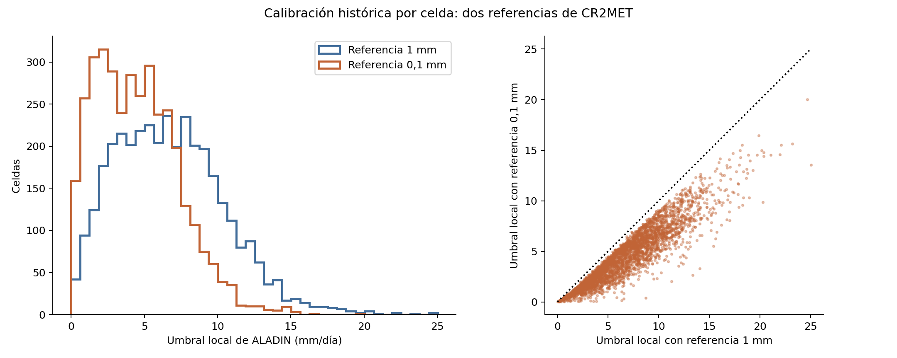
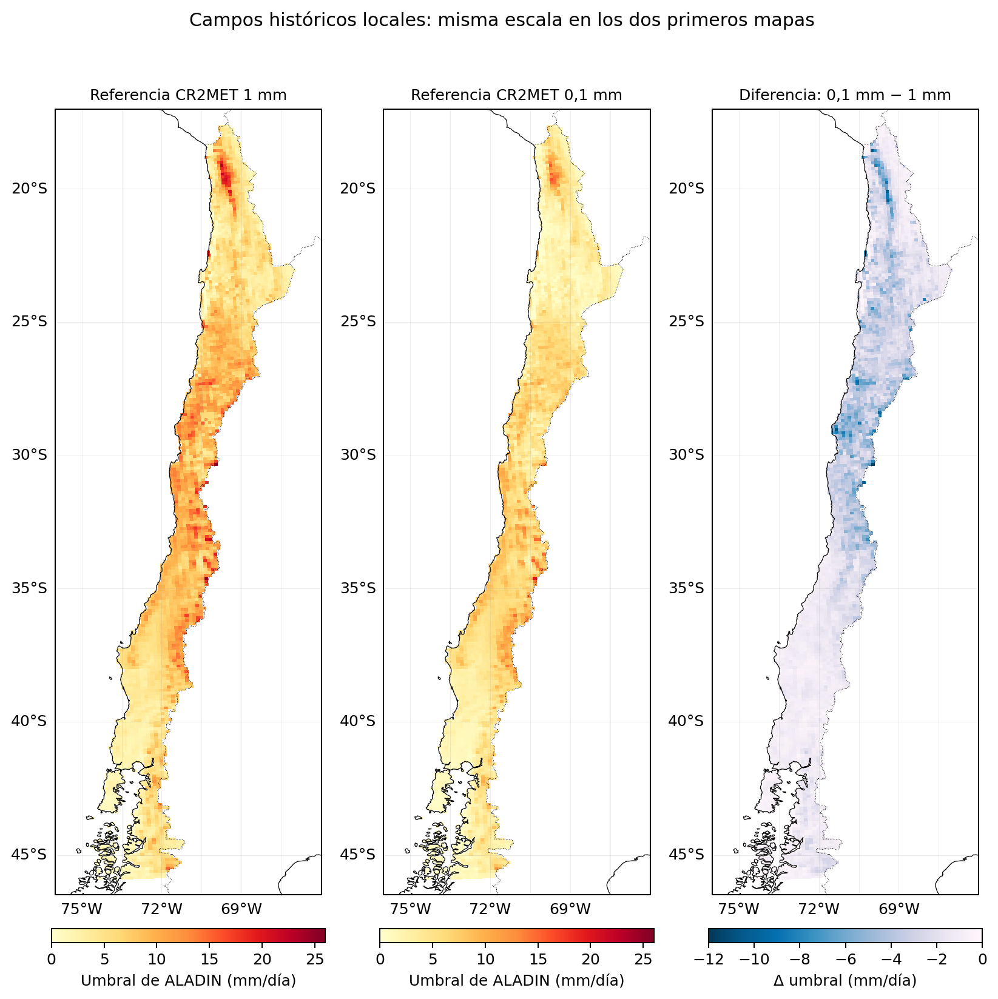
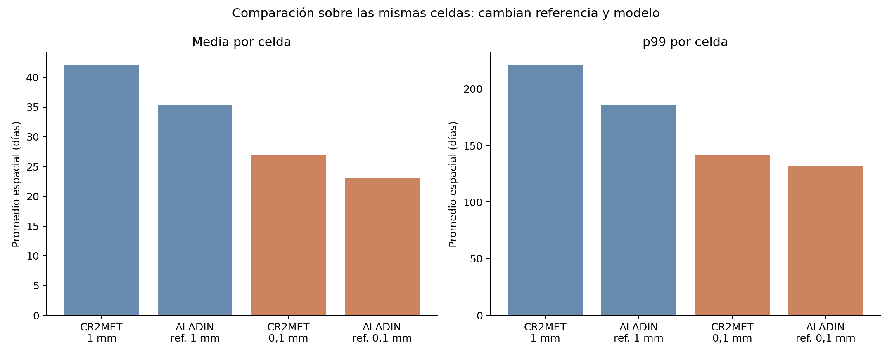
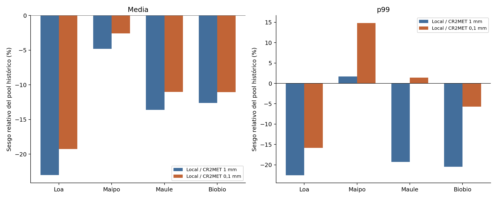
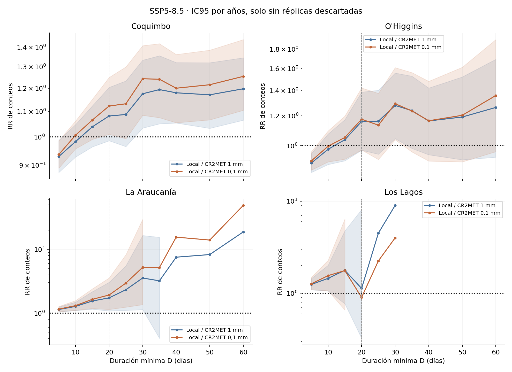

# Comparativa completa: umbral local por celda con CR2MET a 1 y 0,1 mm/día

Fecha: 25 de octubre de 2026. Todos los análisis anteriores se conservan.

## 1. Resultado principal y alcance

En las mismas 3549 celdas, el sesgo de la duración media pasa de -6.727 a -3.989 días y el error absoluto medio pasa de 6.884 a 4.052 días. Para rachas ≥20 días bajo SSP5-8.5, el número de regiones con aumento significativo pasa de 1 con la referencia de 1 mm a 2 con la de 0,1 mm.

**La comparación principal es local contra local.** Se repitió toda la cadena científica anterior desde NetCDF, sustituyendo la referencia CR2MET de 1 por 0,1 mm/día y recalibrando ALADIN por celda en el histórico. No se dividieron los umbrales anteriores por diez. El campo histórico de cada experimento se mantuvo fijo en el futuro.

**Esta comparación cambia la definición de racha seca.** Al bajar el umbral de CR2MET también cambia la referencia con la que se evalúa ALADIN. Un MAE menor no demostraría por sí solo que una definición sea mejor ni que el modelo haya mejorado físicamente. Se separan los cambios de CR2MET, los de ALADIN y los de sus diferencias.

## 2. Diseño preservado y versiones conservadas

| Elemento | Definición |
| --- | --- |
| Referencia anterior | CR2MET ≥1 mm/día como día húmedo; ALADIN con campo local correspondiente. |
| Referencia nueva | CR2MET ≥0,1 mm/día como día húmedo; ALADIN con campo local recalibrado. |
| Períodos | 1980–2014 / 2040–2074; 35 años por período. |
| Datos y unidades | Mismos NetCDF; ALADIN ×86 400 a mm/día. |
| Regrillado | Interpolar precipitación linealmente antes de clasificar días. |
| Territorio | Mismas 3 587 celdas de Chile en el dominio 17,7°S–45,9°S. |
| Ventanas | Loa, Maipo, Maule y Biobío, como cajas geográficas. |
| Regiones | Coquimbo, O’Higgins, La Araucanía y Los Lagos, con las máscaras administrativas previas. |
| Rachas | Censuradas de extremos excluidas; NaN interrumpe; se conserva la duración completa. |
| Bootstrap | 1 000 réplicas, años independientes, mismas semillas. |
| RR | N_fut/N_hist de rachas ≥D con inicio mar–nov; se informan descartes por denominador cero. |
| Mínimo | ≥30 rachas completas por celda y producto, con sensibilidad a 50/100/200. |

Se conservan la raíz del paper, la prueba global anterior de 0,1 mm y la prueba local anterior de 1 mm. La carpeta actual congela los resultados locales a 1 mm en `referencia_local_1mm/`, y los controles globales a 0,1 mm en `referencia_global_0p1mm/`. Los hashes antes/después comprueban su integridad. No se editaron los Docs del paper.

Los identificadores A (global), B (igual umbral en ambos) y C (local) se conservan en las tablas de sensibilidad y bootstrap. El análisis principal usa C. Algunos nombres heredados contienen `i_global` o `integrado`, pero en las salidas principales de esta carpeta contienen el análisis local. La sensibilidad escalar usa ahora 0,1 mm en ALADIN, no 1 mm.

## 3. Calibración por celda

| referencia | celdas_dominio | ampliaron_busqueda | umbral_min | umbral_p10 | umbral_mediana | umbral_p90 | umbral_max | max_error_absoluto_pp |
| --- | --- | --- | --- | --- | --- | --- | --- | --- |
| 1 mm | 3587 | 82 | 0.039 | 2.285 | 6.489 | 11.602 | 25.026 | 0.008 |
| 0,1 mm | 3587 | 5 | 0.010 | 1.135 | 4.241 | 8.203 | 20.006 | 0.008 |

Los umbrales están en mm/día. La tolerancia es 0,0001 en fracción (0,01 puntos porcentuales). Se mantiene el algoritmo anterior: bisección en [0,15] y ampliación al máximo histórico finito de la celda, desplazado al siguiente valor representable, solo si el intervalo inicial no contiene la solución. No se sustituyen celdas sin solución por un umbral global. El campo se guarda en float32 sin redondear a tres decimales.

En la referencia nueva quedan 0 celdas fuera de tolerancia. La cobertura adicional fuera de la máscara nacional necesaria para los RR es de 0 celdas. En las series de calibración se registraron 0 valores no finitos de CR2MET y 0 de ALADIN.

Los dos primeros mapas usan la misma escala; el tercero muestra el umbral con referencia 0,1 mm menos el umbral con referencia 1 mm.

Fuente: `01_calibracion_por_celda.csv`, con las 3 587 correspondencias y sus errores de frecuencia. `calibracion_local.json` describe el ajuste aplicado; `calibracion_R0.json` y la figura global conservada describen únicamente la sensibilidad escalar auxiliar a 0,1 mm.

## 4. Frecuencia húmeda histórica y futura en ventanas

| zona | CR2MET_pct_1mm | CR2MET_pct_0p1mm | ALADIN_R0_pct_1mm | ALADIN_R0_pct_0p1mm | exceso_R0_pp_1mm | exceso_R0_pp_0p1mm |
| --- | --- | --- | --- | --- | --- | --- |
| Dominio | 20.945 | 23.472 | 20.945 | 23.472 | 0.000 | 0.000 |
| Loa | 3.204 | 4.977 | 3.204 | 4.976 | 0.000 | -0.001 |
| Maipo | 16.125 | 18.557 | 16.124 | 18.557 | 0.000 | 0.000 |
| Maule | 19.886 | 21.388 | 19.886 | 21.387 | 0.000 | -0.001 |
| Biobio | 30.738 | 32.517 | 30.738 | 32.517 | 0.000 | 0.000 |

Ambos experimentos igualan su propia referencia histórica anual. La referencia de 0,1 mm clasifica como húmedos días que con 1 mm eran secos; ello también cambia el umbral local de ALADIN. La igualdad anual no exige igualdad estacional.

Frecuencia húmeda futura, manteniendo fijo cada campo histórico:

| zona | ALADIN_R0_ssp585_2040_2074_pct_1mm | ALADIN_R0_ssp585_2040_2074_pct_0p1mm | cambio_rel_ssp585_pct_1mm | cambio_rel_ssp585_pct_0p1mm | cambio_rel_ssp370_pct_1mm | cambio_rel_ssp370_pct_0p1mm |
| --- | --- | --- | --- | --- | --- | --- |
| Dominio | 19.780 | 22.114 | -5.561 | -5.782 | -4.107 | -3.968 |
| Loa | 3.238 | 4.866 | 1.062 | -2.204 | 21.978 | 18.086 |
| Maipo | 14.126 | 16.211 | -12.394 | -12.646 | -13.009 | -12.817 |
| Maule | 17.314 | 18.621 | -12.932 | -12.936 | -12.479 | -12.212 |
| Biobio | 27.618 | 29.295 | -10.150 | -9.908 | -8.249 | -8.088 |

Fuente: `02_frecuencia_ventanas.csv`. Los cambios relativos son respecto del histórico de cada experimento; no son puntos porcentuales.

## 5. Frecuencia anual y estacional en regiones administrativas

| region | estacion | CR2MET_pct_1mm | CR2MET_pct_0p1mm | local_pct_1mm | local_pct_0p1mm | exceso_local_pp_1mm | exceso_local_pp_0p1mm |
| --- | --- | --- | --- | --- | --- | --- | --- |
| Coquimbo | anual | 8.512 | 11.508 | 8.512 | 11.508 | 0.000 | 0.000 |
| O'Higgins | anual | 17.509 | 19.368 | 17.509 | 19.368 | 0.000 | 0.000 |
| La Araucanía | anual | 39.081 | 41.415 | 39.081 | 41.415 | 0.000 | 0.000 |
| Los Lagos | anual | 57.736 | 61.442 | 57.736 | 61.442 | 0.000 | 0.000 |
| Coquimbo | mar-nov | 9.577 | 12.284 | 10.555 | 13.680 | 0.978 | 1.396 |
| O'Higgins | mar-nov | 21.758 | 23.531 | 22.224 | 24.424 | 0.466 | 0.893 |
| La Araucanía | mar-nov | 45.109 | 47.277 | 45.254 | 47.669 | 0.146 | 0.392 |
| Los Lagos | mar-nov | 62.302 | 65.908 | 61.386 | 64.928 | -0.916 | -0.980 |

Se usan las mismas máscaras de los RR. Marzo–noviembre no es el objetivo de calibración: controlar la frecuencia anual no garantiza igualar la frecuencia de esos meses. Fuente: `03_frecuencia_regiones.csv`.

## 6. Duraciones históricas por celda: referencia, modelo y errores

Las filas de «muestra propia» conservan la selección válida de cada configuración; «mismas celdas» restringe ambas a la intersección y elimina el efecto de cambiar la cobertura. En el informe anterior, global 1 mm frente a local 1 mm, se usó una intersección de 3 526 celdas. La comparación local 1 mm frente a local 0,1 mm tiene su propia intersección. Por eso el MAE de la versión local de 1 mm puede aparecer aquí con otro promedio: cambia la muestra de celdas, no sus resultados. La sección de las cuatro versiones incluye una muestra común adicional.

| metrica | muestra | celdas_1mm | celdas_0p1mm | CR2MET_1mm | CR2MET_0p1mm | ALADIN_1mm | ALADIN_0p1mm | sesgo_1mm | sesgo_0p1mm | MAE_1mm | MAE_0p1mm |
| --- | --- | --- | --- | --- | --- | --- | --- | --- | --- | --- | --- |
| mean | muestra propia | 3549 | 3583 | 42.059 | 29.026 | 35.332 | 24.789 | -6.727 | -4.238 | 6.884 | 4.315 |
| mean | mismas celdas | 3549 | 3549 | 42.059 | 26.994 | 35.332 | 23.005 | -6.727 | -3.989 | 6.884 | 4.052 |
| t99 | muestra propia | 3549 | 3583 | 221.078 | 151.221 | 185.416 | 139.783 | -35.662 | -11.438 | 50.507 | 26.505 |
| t99 | mismas celdas | 3549 | 3549 | 221.078 | 141.357 | 185.416 | 131.848 | -35.662 | -9.509 | 50.507 | 24.241 |

`mean` es la duración media por celda y `t99` su percentil 99. Todos los valores de duración y error están en días. El sesgo firmado es ALADIN−CR2MET; el MAE promedia |ALADIN−CR2MET| por celda. Un cambio de MAE entre estas dos referencias no evalúa exactamente la misma variable física.

Descomposición sobre las mismas celdas:

| metrica | cambio_ALADIN_comunes | cambio_CR2MET_comunes | cambio_sesgo_comunes | error_rel_absoluto_1mm_pct | error_rel_absoluto_0p1mm_pct |
| --- | --- | --- | --- | --- | --- |
| mean | -12.327 | -15.065 | 2.738 | 13.728 | 12.795 |
| t99 | -53.567 | -79.720 | 26.153 | 19.378 | 17.010 |

La identidad es Δsesgo = ΔALADIN − ΔCR2MET. El error relativo absoluto divide el error por la métrica de CR2MET de la misma celda antes de promediar; ayuda a contextualizar la escala, pero no elimina el cambio de definición. Fuentes: `04_resumen_espacial.csv` y `05_metricas_por_celda.csv`.

## 7. Significancia histórica y resultados en ventanas

| metrica | muestra | menor_sig_1mm_pct | menor_sig_0p1mm_pct | mayor_sig_1mm_pct | mayor_sig_0p1mm_pct |
| --- | --- | --- | --- | --- | --- |
| mean | muestra propia | 49.112 | 52.665 | 0.225 | 0.949 |
| mean | mismas celdas | 49.112 | 53.142 | 0.225 | 0.958 |
| t99 | muestra propia | 25.444 | 15.183 | 4.903 | 11.248 |
| t99 | mismas celdas | 25.444 | 15.216 | 4.903 | 11.327 |

Los porcentajes proceden de los bootstrap por celda de cada experimento y se restringen a la muestra indicada. No se aplica corrección por comparaciones múltiples.

Promedio espacial de diferencias por ventana:

| metrica | zona | celdas_validas_1mm | celdas_validas_0p1mm | delta_promedio_1mm | delta_promedio_0p1mm |
| --- | --- | --- | --- | --- | --- |
| Duración media | Loa | 298 | 298 | -16.953 | -8.818 |
| Duración media | Maipo | 154 | 154 | -0.940 | -0.646 |
| Duración media | Maule | 171 | 171 | -1.397 | -1.052 |
| Duración media | Biobio | 243 | 243 | -0.826 | -0.674 |
| Duración media | Todo el dominio | 3549 | 3583 | -6.727 | -4.238 |
| Percentil 99 | Loa | 298 | 298 | -127.177 | -42.296 |
| Percentil 99 | Maipo | 154 | 154 | 0.588 | 12.764 |
| Percentil 99 | Maule | 171 | 171 | -17.109 | 1.158 |
| Percentil 99 | Biobio | 243 | 243 | -9.354 | -3.047 |
| Percentil 99 | Todo el dominio | 3549 | 3583 | -35.662 | -11.438 |

Sesgos relativos de los pools de rachas:

| ventana | media_1mm | media_0p1mm | media_sesgo_rel_pct_1mm | media_sesgo_rel_pct_0p1mm | p99_1mm | p99_0p1mm | p99_sesgo_rel_pct_1mm | p99_sesgo_rel_pct_0p1mm |
| --- | --- | --- | --- | --- | --- | --- | --- | --- |
| Loa | 50.492 | 35.368 | -23.006 | -19.260 | 353.000 | 255.000 | -22.588 | -15.842 |
| Maipo | 10.434 | 9.262 | -4.796 | -2.591 | 121.000 | 93.000 | 1.681 | 14.815 |
| Maule | 8.171 | 7.750 | -13.621 | -11.029 | 67.000 | 63.000 | -19.277 | 1.417 |
| Biobio | 5.438 | 5.209 | -12.634 | -11.047 | 35.000 | 33.000 | -20.455 | -5.714 |

El promedio espacial y la estadística del pool no son intercambiables: el pool pesa cada racha por igual, por lo que las celdas con más rachas aportan más eventos. Las curvas llamadas PDFs en la cadena conservan conteos por ancho de intervalo; su integral es el número de rachas y no uno. Por eso un cambio de altura puede reflejar tanto cambios de conteo como de forma distributiva. Fuentes: `06_sesgo_ventanas.csv`, `07_tabla3_completa.csv`. Esta última conserva además CR2MET, mediana, p90, máximos y conteos/fracciones ≥20 días.

## 8. Cambios futuros de las distribuciones en ventanas

| ventana | referencia | N_hist | N_fut | cambio_N_pct | media_hist | media_fut | cambio_media_dias | cambio_media_pct | p99_hist | p99_fut | cambio_p99_dias | cambio_p99_pct |
| --- | --- | --- | --- | --- | --- | --- | --- | --- | --- | --- | --- | --- |
| Loa | local 1 mm | 71662 | 69351 | -3.225 | 50.492 | 52.205 | 1.713 | 3.393 | 353.000 | 368.500 | 15.500 | 4.391 |
| Maipo | local 1 mm | 157567 | 139345 | -11.565 | 10.434 | 11.982 | 1.548 | 14.836 | 121.000 | 138.000 | 17.000 | 14.050 |
| Maule | local 1 mm | 213758 | 186180 | -12.902 | 8.171 | 9.624 | 1.453 | 17.782 | 67.000 | 89.000 | 22.000 | 32.836 |
| Biobio | local 1 mm | 395037 | 366529 | -7.217 | 5.438 | 6.112 | 0.674 | 12.394 | 35.000 | 41.000 | 6.000 | 17.143 |
| Loa | local 0,1 mm | 101023 | 95236 | -5.728 | 35.368 | 37.599 | 2.231 | 6.308 | 255.000 | 273.000 | 18.000 | 7.059 |
| Maipo | local 0,1 mm | 172448 | 151913 | -11.908 | 9.262 | 10.733 | 1.471 | 15.882 | 93.000 | 123.000 | 30.000 | 32.258 |
| Maule | local 0,1 mm | 221195 | 194145 | -12.229 | 7.750 | 9.091 | 1.341 | 17.303 | 63.000 | 81.000 | 18.000 | 28.571 |
| Biobio | local 0,1 mm | 401930 | 374135 | -6.915 | 5.209 | 5.850 | 0.641 | 12.306 | 33.000 | 38.000 | 5.000 | 15.152 |

Los cambios H→F se calculan dentro de cada definición, con su campo histórico fijo. Son resultados descriptivos: la cadena no calcula IC95 de los cambios de media o p99 de la Tabla 3. Comparar dos estimaciones puntuales no prueba que sean estadísticamente diferentes. Fuente: `08_cambios_futuros_ventanas.csv`.

## 9. RR principal de rachas de al menos 20 días

| región | RR / 1 mm | resultado / 1 mm | RR / 0,1 mm | resultado / 0,1 mm |
| --- | --- | --- | --- | --- |
| Coquimbo | 1.082 [0.986; 1.204] | IC incluye 1 | 1.123 [1.010; 1.250] | aumento |
| O'Higgins | 1.160 [0.974; 1.386] | IC incluye 1 | 1.175 [0.975; 1.422] | IC incluye 1 |
| La Araucanía | 1.734 [1.080; 3.045] | aumento | 1.924 [1.141; 3.563] | aumento |
| Los Lagos | 1.131 [0.326; 8.114] | IC incluye 1 | 0.903 [0.203; 11.515] | IC incluye 1 |

Conteos que sostienen esos cocientes:

| region | N_hist_1mm | N_fut_1mm | N_hist_0p1mm | N_fut_0p1mm | descartadas_1mm | descartadas_0p1mm |
| --- | --- | --- | --- | --- | --- | --- |
| Coquimbo | 26613 | 28788 | 24623 | 27647 | 0 | 0 |
| O'Higgins | 8202 | 9511 | 7505 | 8821 | 0 | 0 |
| La Araucanía | 2185 | 3789 | 1637 | 3149 | 0 | 0 |
| Los Lagos | 328 | 371 | 206 | 186 | 0 | 1 |

Un aumento significativo exige IC95 inferior >1. Que un resultado sea significativo en una definición y no en otra no constituye un contraste estadístico de la diferencia entre los dos RR. Un cociente alto puede estar asociado a una base histórica pequeña; por eso se conservan sus conteos y réplicas descartadas. Fuente: `09_RR_D20.csv`.

## 10. Curvas RR y sensibilidad al escenario

SSP3-7.0, con el mismo campo histórico local de cada definición:

| región | RR / 1 mm | resultado / 1 mm | RR / 0,1 mm | resultado / 0,1 mm |
| --- | --- | --- | --- | --- |
| Coquimbo | 1.053 [0.948; 1.176] | IC incluye 1 | 1.092 [0.979; 1.232] | IC incluye 1 |
| O'Higgins | 1.097 [0.939; 1.291] | IC incluye 1 | 1.119 [0.951; 1.336] | IC incluye 1 |
| La Araucanía | 1.555 [1.004; 2.592] | aumento | 1.574 [0.948; 2.791] | IC incluye 1 |
| Los Lagos | 1.979 [0.601; 14.364] | IC incluye 1 | 1.563 [0.378; 21.543] | IC incluye 1 |

Sensibilidad con igual umbral escalar en ambos productos: 1 mm en la referencia anterior y 0,1 mm en la nueva. **Estas filas son sensibilidades sin ajuste local**, conservadas para repetir el trabajo anterior:

| región | RR / 1 mm | resultado / 1 mm | RR / 0,1 mm | resultado / 0,1 mm |
| --- | --- | --- | --- | --- |
| Coquimbo | 1.212 [1.062; 1.391] | aumento | 1.360 [1.172; 1.588] | aumento |
| O'Higgins | 1.174 [0.956; 1.466] | IC incluye 1 | 1.643 [1.250; 2.257] | aumento |
| La Araucanía | 3.969 [1.456; 16.958] | aumento | 36.750 [8.279; 183.325] | aumento |
| Los Lagos | 0.252 [0.014; 28.075] | IC incluye 1 | nan [nan; nan] | no definido |

Cambios de decisión a lo largo de las duraciones:

| escenario | region | D | RR_1mm | RR_0p1mm | decision_1mm | decision_0p1mm |
| --- | --- | --- | --- | --- | --- | --- |
| SSP5-8.5 | Coquimbo | 20 | 1.082 | 1.123 | IC incluye 1 | aumento |
| SSP3-7.0 | Coquimbo | 30 | 1.096 | 1.167 | IC incluye 1 | aumento |
| SSP3-7.0 | La Araucanía | 20 | 1.555 | 1.574 | aumento | IC incluye 1 |
| SSP3-7.0 | La Araucanía | 30 | 2.907 | 4.627 | IC incluye 1 | aumento |
| SSP3-7.0 | Los Lagos | 15 | 2.203 | 2.090 | aumento | IC incluye 1 |
| igual umbral escalar | Coquimbo | 10 | 1.059 | 1.143 | IC incluye 1 | aumento |
| igual umbral escalar | O'Higgins | 5 | 0.987 | 1.071 | IC incluye 1 | aumento |
| igual umbral escalar | O'Higgins | 10 | 1.079 | 1.219 | IC incluye 1 | aumento |
| igual umbral escalar | O'Higgins | 15 | 1.091 | 1.484 | IC incluye 1 | aumento |
| igual umbral escalar | O'Higgins | 20 | 1.174 | 1.643 | IC incluye 1 | aumento |
| igual umbral escalar | O'Higgins | 25 | 1.123 | 1.518 | IC incluye 1 | aumento |
| igual umbral escalar | O'Higgins | 30 | 1.329 | 1.842 | IC incluye 1 | aumento |
| igual umbral escalar | O'Higgins | 35 | 1.403 | 1.934 | IC incluye 1 | aumento |
| igual umbral escalar | O'Higgins | 50 | 1.541 | 3.208 | IC incluye 1 | aumento |
| igual umbral escalar | O'Higgins | 60 | 1.905 | 3.931 | IC incluye 1 | aumento |
| igual umbral escalar | La Araucanía | 25 | 16.448 | — | aumento | no definido |
| igual umbral escalar | La Araucanía | 30 | 54.000 | — | IC incluye 1 | no definido |
| igual umbral escalar | Los Lagos | 10 | 1.770 | 1.990 | aumento | IC incluye 1 |
| igual umbral escalar | Los Lagos | 20 | 0.252 | — | IC incluye 1 | no definido |

`10_RR_todas_duraciones.csv` contiene los 120 puntos de cada versión emparejados: dos escenarios locales y una sensibilidad escalar, cuatro regiones y diez duraciones. No se interpreta la falta de significancia como ausencia de cambio. Las bandas se muestran solo donde no se descartaron réplicas.

## 11. Frecuencia seca y persistencia de primer orden

| region | frec_seca_delta_1mm | frec_seca_delta_0p1mm | frec_seca_delta_IC95_inf_0p1mm | frec_seca_delta_IC95_sup_0p1mm | rho_delta_1mm | rho_delta_0p1mm | rho_delta_IC95_inf_0p1mm | rho_delta_IC95_sup_0p1mm | rho_IC_incluye_0_1mm | rho_IC_incluye_0_0p1mm |
| --- | --- | --- | --- | --- | --- | --- | --- | --- | --- | --- |
| Coquimbo | 0.016 | 0.020 | 0.007 | 0.033 | -0.015 | -0.018 | -0.046 | 0.013 | sí | sí |
| O'Higgins | 0.028 | 0.030 | 0.011 | 0.046 | 0.005 | 0.007 | -0.025 | 0.038 | sí | sí |
| La Araucanía | 0.039 | 0.039 | 0.018 | 0.059 | 0.003 | 0.006 | -0.019 | 0.030 | sí | sí |
| Los Lagos | 0.026 | 0.025 | 0.006 | 0.045 | 0.023 | 0.028 | 0.004 | 0.052 | sí | no |

La frecuencia seca se expresa como fracción: multiplicar por 100 para puntos porcentuales. ρ = P(seco hoy|seco ayer) − P(seco hoy|húmedo ayer). La calibración de frecuencia anual no impone su valor ni su cambio. Los intervalos reflejan remuestreo de años, sin recalibrar el campo en cada réplica. Fuente: `11_persistencia.csv`.

## 12. Diagnóstico Markov

| region | RR_obs_1mm | RR_solo_frec_1mm | solo_frec_dentro_IC95_obs_1mm | RR_obs_0p1mm | RR_solo_frec_0p1mm | cobertura_markov_hist_0p1mm | solo_frec_dentro_IC95_obs_0p1mm |
| --- | --- | --- | --- | --- | --- | --- | --- |
| Coquimbo | 1.082 | 1.039 | sí | 1.123 | 1.081 | 1.018 | sí |
| O'Higgins | 1.160 | 1.185 | sí | 1.175 | 1.222 | 0.981 | sí |
| La Araucanía | 1.734 | 1.789 | sí | 1.924 | 1.873 | 0.892 | sí |
| Los Lagos | 1.131 | 1.820 | sí | 0.903 | 1.911 | 0.433 | sí |

Casos con al menos 100 rachas históricas:

| referencia | casos | compatibles |
| --- | --- | --- |
| 1mm | 30 | 30 |
| 0p1mm | 29 | 29 |

La cobertura histórica es N_hist Markov/N_hist observado; un valor alejado de uno limita la representación del nivel histórico. El diagnóstico expresa compatibilidad con una referencia de primer orden, no atribución causal exclusiva. La dispersión de simulaciones no incluye incertidumbre de estimación de parámetros. Fuente: `12_markov.csv`.

## 13. Censura, mínimo de rachas y regrillado

### Rachas censuradas

| serie | cuenca | rachas_completas_1mm | rachas_completas_0p1mm | censuradas_1mm | censuradas_0p1mm | pct_censuradas_1mm | pct_censuradas_0p1mm |
| --- | --- | --- | --- | --- | --- | --- | --- |
| CR2MET hist | Loa | 55015 | 81422 | 596 | 596 | 1.072 | 0.727 |
| CR2MET hist | Maipo | 150209 | 168183 | 244 | 244 | 0.162 | 0.145 |
| CR2MET hist | Maule | 184462 | 196589 | 284 | 268 | 0.154 | 0.136 |
| CR2MET hist | Biobio | 344251 | 357067 | 339 | 310 | 0.098 | 0.087 |
| ALADIN 1980-2014 (R0) | Loa | 71662 | 101023 | 529 | 506 | 0.733 | 0.498 |
| ALADIN 1980-2014 (R0) | Maipo | 157567 | 172448 | 279 | 270 | 0.177 | 0.156 |
| ALADIN 1980-2014 (R0) | Maule | 213758 | 221195 | 342 | 342 | 0.160 | 0.154 |
| ALADIN 1980-2014 (R0) | Biobio | 395037 | 401930 | 481 | 474 | 0.122 | 0.118 |
| ALADIN 2040-2074 (R0) | Loa | 69351 | 95236 | 588 | 583 | 0.841 | 0.608 |
| ALADIN 2040-2074 (R0) | Maipo | 139345 | 151913 | 308 | 308 | 0.221 | 0.202 |
| ALADIN 2040-2074 (R0) | Maule | 186180 | 194145 | 342 | 342 | 0.183 | 0.176 |
| ALADIN 2040-2074 (R0) | Biobio | 366529 | 374135 | 486 | 486 | 0.132 | 0.130 |

Se mantiene la exclusión de rachas que tocan extremos del período; su número puede cambiar al reclasificar días.

### Mínimo de rachas

| minimo_rachas | celdas_1mm | celdas_0p1mm | delta_media_promedio_1mm | delta_media_promedio_0p1mm | delta_t99_promedio_1mm | delta_t99_promedio_0p1mm |
| --- | --- | --- | --- | --- | --- | --- |
| 30 | 3549 | 3583 | -6.727 | -4.238 | -35.662 | -11.438 |
| 50 | 3470 | 3564 | -5.802 | -4.052 | -31.478 | -9.964 |
| 100 | 3226 | 3461 | -4.403 | -3.565 | -20.258 | -6.715 |
| 200 | 2801 | 3061 | -2.752 | -2.500 | -10.476 | -3.592 |

Esta sensibilidad cambia la selección de celdas y restringe la significancia ya calculada; no recalcula un bootstrap distinto por cada mínimo.

### Regrillado

| cr2met | metrica | CR2MET_1mm | CR2MET_0p1mm | ALADIN_1mm | ALADIN_0p1mm | Delta_1mm | Delta_0p1mm | pix_1mm | pix_0p1mm |
| --- | --- | --- | --- | --- | --- | --- | --- | --- | --- |
| lineal | media | 42.059 | 29.026 | 35.332 | 24.789 | -6.727 | -4.238 | 3549 | 3583 |
| lineal | t99 | 221.078 | 151.221 | 185.416 | 139.783 | -35.662 | -11.438 | 3549 | 3583 |
| area | media | 41.851 | 26.959 | 35.244 | 22.905 | -6.608 | -4.054 | 3552 | 3586 |
| area | t99 | 219.310 | 141.400 | 185.076 | 131.058 | -34.234 | -10.342 | 3552 | 3586 |

El criterio `i` identifica el análisis local principal en esta prueba; se conservan las alternativas en el CSV. El método alternativo promedia celdas cuyos centros caen dentro de la celda ALADIN; no es conservación estricta por áreas de solape. Se recalibran los campos locales frente a cada referencia de regrillado. Fuentes: `13_censuradas.csv`, `14_minimo_rachas.csv`, `15_regrillado.csv`.

**Corrección de precisión auxiliar:** el primer control detectó una racha de CR2MET adicional en Biobío en el diagnóstico de censura (357 068 frente a 357 067), debido al redondeo de la caché interpolada a float32 cerca de 0,1 mm. Se conservó esa primera salida en `revision_precision_float32/` y se regeneró la caché en float64, manteniendo pesos, fechas y máscara. En la interpolación lineal, ese redondeo cambia la clasificación de 17 días-celda en 17 celdas. En el promedio alternativo por centros son 3767 días-celda en 1877 celdas. Se repitieron regrillado, censura y T01, y se verificaron el campo local y las métricas lineales frente al principal. La calibración, bootstrap, PDFs, Tabla 3, RR y persistencia principales ya usaban la precisión canónica y no se modificaron por esta corrección. Véanse `NOTA_PRECISION.md` y `precision_auxiliar.json`.

## 14. Comparación adicional: referencia y escala de calibración

Esta tabla distingue las dos decisiones: referencia de CR2MET (1 o 0,1 mm) y calibración de ALADIN (global o por celda). La comparación dentro de una misma referencia mantiene fijo el significado de la racha observada. La comparación entre referencias cambia su definición.

| referencia | calibracion | metrica | muestra | celdas | CR2MET | ALADIN | sesgo | MAE |
| --- | --- | --- | --- | --- | --- | --- | --- | --- |
| 1 mm | global | mean | mismas celdas de las cuatro versiones | 3526 | 40.991 | 32.760 | -8.230 | 14.890 |
| 1 mm | local | mean | mismas celdas de las cuatro versiones | 3526 | 40.991 | 34.469 | -6.522 | 6.673 |
| 0,1 mm | global | mean | mismas celdas de las cuatro versiones | 3526 | 26.501 | 25.803 | -0.698 | 9.452 |
| 0,1 mm | local | mean | mismas celdas de las cuatro versiones | 3526 | 26.501 | 22.661 | -3.841 | 3.904 |
| 1 mm | global | t99 | mismas celdas de las cuatro versiones | 3526 | 215.816 | 169.556 | -46.260 | 71.473 |
| 1 mm | local | t99 | mismas celdas de las cuatro versiones | 3526 | 215.816 | 181.720 | -34.096 | 48.825 |
| 0,1 mm | global | t99 | mismas celdas de las cuatro versiones | 3526 | 138.803 | 139.697 | 0.894 | 40.225 |
| 0,1 mm | local | t99 | mismas celdas de las cuatro versiones | 3526 | 138.803 | 130.212 | -8.592 | 23.376 |

RR a D=20 bajo SSP5-8.5:

| referencia | calibracion | region | N_hist | N_fut | RR | IC_inf | IC_sup | decision |
| --- | --- | --- | --- | --- | --- | --- | --- | --- |
| 1 mm | global | Coquimbo | 25367 | 28458 | 1.122 | 1.008 | 1.250 | aumento |
| 1 mm | global | O'Higgins | 7015 | 8096 | 1.154 | 0.949 | 1.403 | IC incluye 1 |
| 1 mm | global | La Araucanía | 2397 | 4118 | 1.718 | 1.101 | 2.881 | aumento |
| 1 mm | global | Los Lagos | 601 | 1291 | 2.148 | 0.902 | 8.502 | IC incluye 1 |
| 1 mm | local | Coquimbo | 26613 | 28788 | 1.082 | 0.986 | 1.204 | IC incluye 1 |
| 1 mm | local | O'Higgins | 8202 | 9511 | 1.160 | 0.974 | 1.386 | IC incluye 1 |
| 1 mm | local | La Araucanía | 2185 | 3789 | 1.734 | 1.080 | 3.045 | aumento |
| 1 mm | local | Los Lagos | 328 | 371 | 1.131 | 0.326 | 8.114 | IC incluye 1 |
| 0,1 mm | global | Coquimbo | 23911 | 27308 | 1.142 | 1.020 | 1.277 | aumento |
| 0,1 mm | global | O'Higgins | 6286 | 7106 | 1.130 | 0.929 | 1.386 | IC incluye 1 |
| 0,1 mm | global | La Araucanía | 1542 | 2933 | 1.902 | 1.121 | 3.691 | aumento |
| 0,1 mm | global | Los Lagos | 337 | 697 | 2.068 | 0.666 | 13.944 | IC incluye 1 |
| 0,1 mm | local | Coquimbo | 24623 | 27647 | 1.123 | 1.010 | 1.250 | aumento |
| 0,1 mm | local | O'Higgins | 7505 | 8821 | 1.175 | 0.975 | 1.422 | IC incluye 1 |
| 0,1 mm | local | La Araucanía | 1637 | 3149 | 1.924 | 1.141 | 3.563 | aumento |
| 0,1 mm | local | Los Lagos | 206 | 186 | 0.903 | 0.203 | 11.515 | IC incluye 1 |

Fuentes: `17_comparacion_cuatro_versiones_historico.csv` y `18_comparacion_cuatro_versiones_RR.csv`. El segundo contiene las cuatro configuraciones, ambos escenarios y las diez duraciones. Las referencias globales conservan sus resultados previos; la cadena nueva vuelve a verificar sus controles históricos globales y escalares de 0,1 mm.

## 15. Implicaciones para el paper y límites de interpretación

- **Coquimbo, SSP5-8.5 a D=20:** RR 1.082 → 1.123; IC incluye 1 → aumento.
- **O'Higgins, SSP5-8.5 a D=20:** RR 1.160 → 1.175; IC incluye 1 → IC incluye 1.
- **La Araucanía, SSP5-8.5 a D=20:** RR 1.734 → 1.924; aumento → aumento.
- **Los Lagos, SSP5-8.5 a D=20:** RR 1.131 → 0.903; IC incluye 1 → IC incluye 1.
- **Persistencia, referencia 1 mm:** IC95 de Δρ incluye cero en 4 de 4 regiones.
- **Persistencia, referencia 0,1 mm:** IC95 de Δρ incluye cero en 3 de 4 regiones.
- **Cambio detectable de persistencia con referencia 0,1 mm, Los Lagos:** Δρ=0.02800; IC95 [0.00387; 0.05209].

La decisión entre 1 y 0,1 mm debe fundarse en qué precipitación diaria se considera suficiente para interrumpir la racha meteorológica de interés. El ajuste local responde a otra decisión: hacer equivalente la frecuencia histórica de cada celda. Son dos elecciones distintas. Este experimento no elige el umbral por el número de resultados significativos ni por el menor MAE.

Una formulación defendible es: «Se comparó la sensibilidad de las duraciones y sus cambios proyectados a dos referencias de día húmedo de CR2MET, recalibrando en cada caso el umbral histórico de ALADIN por celda y conservándolo fijo en el futuro». Los resultados que cambien de decisión deben describirse como sensibles a esa definición.

Limitaciones conservadas: una simulación de un modelo; incertidumbre de CR2MET; dependencia espacial; calibración con todo el histórico y sin validación temporal independiente; bootstrap con umbrales fijos; igualdad anual que no garantiza igualdad estacional; precipitación en mm sin corregir; umbrales estadísticos sin validación como indicadores de impacto agrícola. El dominio y el alcance de las cuatro regiones permanecen iguales.

Un cambio detectable de ρ y un RR de rachas largas no significativo pueden coexistir: describen estadísticas diferentes y tienen incertidumbres distintas. Detectar Δρ tampoco demuestra que sea la causa exclusiva de las rachas extremas. No se debe trasladar a la referencia de 0,1 mm una conclusión sobre ausencia de cambio detectable de persistencia obtenida con 1 mm.

Los cambios en medias, p99 y RR entre estas dos definiciones no son por sí solos evidencia de un cambio físico del clima: ambas procesan exactamente los mismos datos meteorológicos.

## 16. Verificación e integridad

| control | passed |
| --- | --- |
| Mismas 3587 celdas de calibración | sí |
| Frecuencia húmeda CR2MET no disminuye al bajar referencia | sí |
| Umbral local no aumenta al bajar referencia | sí |
| Todas las celdas locales cumplen tolerancia | sí |
| Campo local 0,1 previo preservado en sus celdas válidas | sí |
| Máscara espacial preservada | sí |
| Identidad cambio sesgo = cambio ALADIN − cambio CR2MET mean | sí |
| Identidad cambio sesgo = cambio ALADIN − cambio CR2MET t99 | sí |
| Control histórico global 0,1 previo idéntico A_opcion_B_integrado/mean | sí |
| Control histórico global 0,1 previo idéntico B_mismo_umbral/mean | sí |
| Local 0,1 previo coincide en celdas previamente válidas mean | sí |
| Control histórico global 0,1 previo idéntico A_opcion_B_integrado/t99 | sí |
| Control histórico global 0,1 previo idéntico B_mismo_umbral/t99 | sí |
| Local 0,1 previo coincide en celdas previamente válidas t99 | sí |
| RR escalar 0,1 idéntico al cálculo previo | sí |
| Acumulados y estacionalidad sin cambios | sí |
| Caché float64 conserva los valores a la precisión float32 previa | sí |
| Controles internos de la cadena | sí |
| Todos los análisis previos y NetCDF preservados | sí |

La cadena pasó 88 controles internos de consistencia. Se verificaron 441 archivos de análisis anteriores y 680 NetCDF; las listas de modificaciones están en `integridad.json`. El inventario compara 72 salidas emparejadas por su función: 2 iguales y 70 diferentes o nuevas.

Los controles global y escalar a 0,1 mm se contrastan con el cálculo global anterior de 0,1 mm, no con la referencia de 1 mm. El campo local anterior de 0,1 mm se verifica en las celdas previamente válidas; la búsqueda ampliada conserva ese comportamiento y resuelve las celdas fuera del intervalo inicial. Los hashes y el diff registran exactamente los scripts finales. Las diferencias esperadas son el objeto del experimento, no fallos de reproducción.

## 17. Archivos y reproducción

- `ejecucion/`: scripts y resultados nuevos, incluidos todos los mapas, PDFs, bootstrap, RR y sensibilidades.
- `referencia_local_1mm/`: copia congelada del experimento local anterior.
- `referencia_global_0p1mm/`: controles del experimento global de 0,1 mm ya existente.
- `comparativa/`: dieciocho CSV comparativos y cinco figuras.
- `estado.json`, `logs/`: estado, comandos, tiempos y errores.
- `controles_consistencia.json`, `controles_comparativa.json`, `integridad.json`: verificaciones.
- `scripts_base_local_1mm/`, `cambios_codigo.diff`, `scripts_ejecutados_sha256.json`: trazabilidad de código.

Entorno científico existente: `~/.pyenv/shims/python3.11`; no se instalaron paquetes. `ejecutar.py` reanuda pasos terminados sin repetirlos. Después de modificar reglas o scripts debe usarse una ejecución nueva, pues no invalida dependencias automáticamente. `repetir_desde_cero.py --destino /ruta/nueva` reproduce todos los cálculos desde NetCDF en otra carpeta sin cachés de análisis. `generar_comparativa.py` regenera este informe y sus tablas desde las salidas calculadas. `preparar.py` conserva la preparación inicial y no debe ejecutarse sobre esta carpeta ya preparada.
