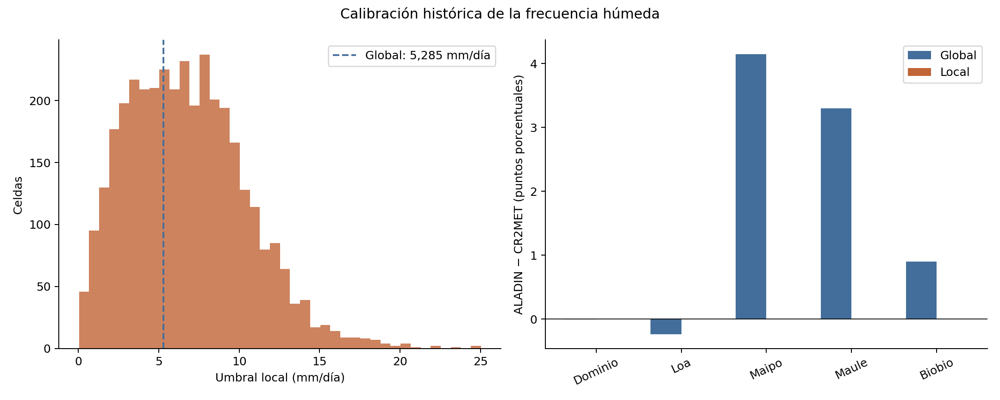
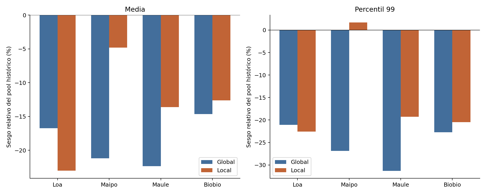
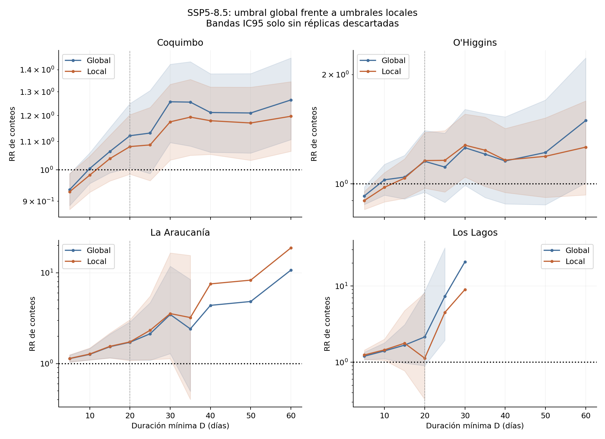

# Comparativa del paper: umbral global frente a umbrales por celda

Fecha: 24 de octubre de 2026. Experimento aislado; los resultados oficiales del paper conservan su versión previa.

## 1. Qué se hizo y qué permite concluir

**Resultado principal:** en las mismas 3526 celdas, el error absoluto medio de la duración media pasa de 14.890 a 6.673 días, y su sesgo firmado de -8.230 a -6.522 días. A D=20, el número de regiones con un aumento cuyo IC95 excluye uno pasa de 2 a 1. Las tablas siguientes identifican cuáles y cómo cambian sus conteos e intervalos.

Se repitió la cadena científica de la raíz con CR2MET a 1 mm/día y un umbral histórico de ALADIN específico por celda. El mismo campo histórico se aplicó a 2040–2074, tanto bajo SSP5-8.5 como en la sensibilidad SSP3-7.0. No se ajustaron las duraciones para que coincidieran.

El experimento permite medir cuánto cambian la evaluación histórica y las proyecciones al controlar la frecuencia húmeda local. Una reducción del sesgo después de calibrar es un resultado condicionado al ajuste; no demuestra una mejora física del modelo ni valida por sí sola sus proyecciones.

## 2. Diseño y condiciones preservadas

| Elemento | Condición |
| --- | --- |
| Datos y unidades | Mismos NetCDF de CR2MET v2.5 y ALADIN CHP12; ALADIN × 86 400 a mm/día. |
| Regrillado principal | Interpolación lineal de precipitación antes de clasificar los días. |
| Períodos | 1980–2014 / 2040–2074, 35 años por período. |
| Dominio | Misma máscara de Chile del paper, 17,7°S–45,9°S. |
| Ventanas | Loa, Maipo, Maule y Biobío; cajas geográficas, no cuencas oficiales. |
| RR regionales | Coquimbo, O’Higgins, La Araucanía y Los Lagos; inicio mar–nov. |
| Rachas | Días pr < umbral; se excluyen rachas que tocan extremos del período; se conserva su duración completa. |
| Bootstrap | 1 000 réplicas; años independientes entre productos/períodos; semillas originales. |
| Métricas por celda | Al menos 30 rachas completas; máscara común entre productos. |
| RR | Conteo futuro / conteo histórico, sin dividir por el total de rachas. |
| Sensibilidades | 1 mm, SSP3-7.0, regrillado por centros y mínimos de 30/50/100/200 rachas. |

Los criterios A (global), B (1 mm) y C (local) conservan sus identificadores dentro del bootstrap y de las tablas de sensibilidad. En esta carpeta el mapa y los análisis principales usan C. Algunas rutas heredadas contienen `i_global` o `integrado`: son identificadores de archivos preservados para mantener la cadena; no describen el umbral principal de este experimento. `calibracion_R0.json` conserva el diagnóstico escalar global como referencia, y su figura original se guarda como `fig03_referencia_umbral_global.png`. La figura 3 principal se adapta al campo local mediante `figura_calibracion_local.py`. El registro del ajuste aplicado es `calibracion_local.json` y el campo `R0_local_map.npz`.

## 3. Calibración local y el límite previo de 15 mm/día

Se calibraron 3587 celdas del dominio. La cobertura adicional necesaria para las máscaras administrativas fue de 0 celdas. El histórico tiene 12784 días; se registraron 0 valores no finitos de CR2MET y 0 de ALADIN en las series usadas para calibrar.

La implementación previa dejaba 82 celdas sin solución por restringir la búsqueda a [0,15] mm/día. En ellas se amplió el extremo superior hasta el máximo histórico finito de la celda, desplazado al siguiente valor representable. En las demás se conservó el intervalo previo. Los 3505 umbrales previos válidos permanecen exactamente iguales: sí. No se reemplazaron las celdas problemáticas por el umbral global.

| Distribución del umbral | mm/día |
| --- | --- |
| Mínimo | 0.039 |
| p10 | 2.285 |
| Mediana | 6.489 |
| p90 | 11.602 |
| Máximo | 25.026 |

La tolerancia de búsqueda es 0.0001 en fracción (0,01 puntos porcentuales). El máximo error absoluto observado es 0.007822 puntos porcentuales; hay 0 celdas fuera de tolerancia. Las frecuencias empíricas son discretas y no identifican necesariamente un único umbral. Se conserva el campo en float32, sin redondearlo a tres decimales.

**Diferencia respecto de la sensibilidad local anterior:** el experimento principal incluye las celdas recuperadas. Por eso el contraste con el criterio local previamente publicado mezcla la ampliación de cobertura con sus resultados; el contraste principal de este informe es global frente a local y se presenta también sobre las mismas celdas.

## 4. Frecuencia húmeda en el dominio y las ventanas

| zona | CR2MET (%) | ALADIN global (%) | ALADIN local (%) | Exceso global (pp) | Exceso local (pp) |
| --- | --- | --- | --- | --- | --- |
| Dominio | 20.945 | 20.944 | 20.945 | -0.001 | 0.000 |
| Loa | 3.204 | 2.965 | 3.204 | -0.239 | 0.000 |
| Maipo | 16.125 | 20.274 | 16.124 | 4.150 | -0.000 |
| Maule | 19.886 | 23.182 | 19.886 | 3.297 | 0.000 |
| Biobio | 30.738 | 31.642 | 30.738 | 0.904 | 0.000 |

La igualdad histórica anual local es un objetivo de calibración, no un resultado independiente de validación. No impone igualdad mensual, estacional, de cantidades de lluvia ni de duraciones. Fuentes: `01_frecuencia_ventanas.csv` y `ejecucion/resultados_tesis/calibracion_local_por_celda.csv`.

## 5. Frecuencia húmeda en las regiones administrativas

| region | estacion | celdas | CR2MET_pct | global_pct | local_pct | exceso_global_pp | exceso_local_pp |
| --- | --- | --- | --- | --- | --- | --- | --- |
| Coquimbo | anual | 239 | 8.512 | 11.237 | 8.512 | 2.724 | 0.000 |
| O'Higgins | anual | 110 | 17.509 | 21.127 | 17.509 | 3.618 | 0.000 |
| La Araucanía | anual | 223 | 39.081 | 38.417 | 39.081 | -0.664 | 0.000 |
| Los Lagos | anual | 324 | 57.736 | 51.678 | 57.736 | -6.057 | 0.000 |
| Coquimbo | mar-nov | 239 | 9.577 | 13.645 | 10.555 | 4.068 | 0.978 |
| O'Higgins | mar-nov | 110 | 21.758 | 26.399 | 22.224 | 4.641 | 0.466 |
| La Araucanía | mar-nov | 223 | 45.109 | 44.513 | 45.254 | -0.596 | 0.146 |
| Los Lagos | mar-nov | 324 | 62.302 | 55.417 | 61.386 | -6.885 | -0.916 |

La tabla usa las mismas máscaras administrativas de los RR. La calibración anual no exige igualdad en marzo–noviembre. Esta distinción importa al interpretar la evaluación de rachas y el diagnóstico de persistencia estacional.

## 6. Evaluación histórica espacial: sesgo, error y cobertura

| metrica | muestra | n_global | n_local | sesgo_global_dias | sesgo_local_dias | MAE_global_dias | MAE_local_dias | pct_menor_sig_global | pct_menor_sig_local | pct_mayor_sig_global | pct_mayor_sig_local | pct_menor_error_local_en_comunes |
| --- | --- | --- | --- | --- | --- | --- | --- | --- | --- | --- | --- | --- |
| mean | muestra propia | 3526 | 3549 | -8.230 | -6.727 | 14.890 | 6.884 | 66.279 | 49.112 | 7.799 | 0.225 | 69.314 |
| mean | mismas celdas | 3526 | 3526 | -8.230 | -6.522 | 14.890 | 6.673 | 66.279 | 49.149 | 7.799 | 0.227 | 69.314 |
| t99 | muestra propia | 3526 | 3549 | -46.260 | -35.662 | 71.473 | 50.507 | 43.052 | 25.444 | 3.744 | 4.903 | 60.408 |
| t99 | mismas celdas | 3526 | 3526 | -46.260 | -34.096 | 71.473 | 48.825 | 43.052 | 25.383 | 3.744 | 4.935 | 60.408 |

`mean` es la duración media por celda y `t99` su percentil 99. MAE es el promedio del error absoluto por celda. El sesgo firmado puede acercarse a cero por compensación entre errores positivos y negativos; el MAE permite revisar esa posibilidad.

La fila «muestra propia» reproduce la selección válida de cada configuración. La fila «mismas celdas» restringe ambas a la intersección, de modo que el contraste no se deba a incorporar o excluir celdas. Los porcentajes significativos proceden del bootstrap original de cada celda, restringido a la muestra indicada. No se aplicó corrección por comparaciones múltiples. Fuentes: `11_resumen_espacial.csv`, `12_metricas_todas_celdas.csv` y NPZ bootstrap.

## 7. Evaluación histórica en ventanas: dos estadísticas diferentes

El promedio espacial de métricas por celda y la métrica del pool de rachas no son intercambiables. En el pool cada racha pesa una vez; una celda con muchas rachas aporta más eventos.

### Promedio espacial de las diferencias por celda

| metrica | zona | celdas_validas_global | celdas_validas_local | delta_promedio_global | delta_promedio_local |
| --- | --- | --- | --- | --- | --- |
| Duración media | Loa | 298 | 298 | -13.460 | -16.953 |
| Duración media | Maipo | 154 | 154 | -2.782 | -0.940 |
| Duración media | Maule | 171 | 171 | -2.240 | -1.397 |
| Duración media | Biobio | 243 | 243 | -0.972 | -0.826 |
| Duración media | Todo el dominio | 3526 | 3549 | -8.230 | -6.727 |
| Percentil 99 | Loa | 298 | 298 | -103.478 | -127.177 |
| Percentil 99 | Maipo | 154 | 154 | -23.590 | 0.588 |
| Percentil 99 | Maule | 171 | 171 | -27.101 | -17.109 |
| Percentil 99 | Biobio | 243 | 243 | -10.686 | -9.354 |
| Percentil 99 | Todo el dominio | 3526 | 3549 | -46.260 | -35.662 |

### Sesgo relativo de las distribuciones agrupadas

| ventana | media_global | media_local | media_sesgo_rel_pct_global | media_sesgo_rel_pct_local | p99_global | p99_local | p99_sesgo_rel_pct_global | p99_sesgo_rel_pct_local |
| --- | --- | --- | --- | --- | --- | --- | --- | --- |
| Loa | 54.603 | 50.492 | -16.738 | -23.006 | 360.000 | 353.000 | -21.053 | -22.588 |
| Maipo | 8.638 | 10.434 | -21.186 | -4.796 | 87.000 | 121.000 | -26.891 | 1.681 |
| Maule | 7.345 | 8.171 | -22.350 | -13.621 | 57.000 | 67.000 | -31.325 | -19.277 |
| Biobio | 5.312 | 5.438 | -14.656 | -12.634 | 34.000 | 35.000 | -22.727 | -20.455 |

Fuentes: `02_sesgo_por_ventana.csv` y `03_tabla3_completa.csv`. La tabla completa también conserva mediana, p90, máximos, conteos y fracciones ≥20 días.

## 8. Cambios futuros de las distribuciones en ventanas

| ventana | calibracion | n_hist | n_fut | cambio_n_pct | media_hist | media_fut | cambio_media_dias | cambio_media_pct | p99_hist | p99_fut | cambio_p99_dias | cambio_p99_pct |
| --- | --- | --- | --- | --- | --- | --- | --- | --- | --- | --- | --- | --- |
| Loa | global | 66267 | 64043 | -3.356 | 54.603 | 56.646 | 2.043 | 3.742 | 360.000 | 385.000 | 25.000 | 6.944 |
| Maipo | global | 181049 | 159887 | -11.689 | 8.638 | 10.023 | 1.385 | 16.034 | 87.000 | 112.000 | 25.000 | 28.736 |
| Maule | global | 228077 | 202463 | -11.230 | 7.345 | 8.551 | 1.206 | 16.419 | 57.000 | 76.000 | 19.000 | 33.333 |
| Biobio | global | 399130 | 370260 | -7.233 | 5.312 | 5.980 | 0.668 | 12.575 | 34.000 | 39.000 | 5.000 | 14.706 |
| Loa | local | 71662 | 69351 | -3.225 | 50.492 | 52.205 | 1.713 | 3.393 | 353.000 | 368.500 | 15.500 | 4.391 |
| Maipo | local | 157567 | 139345 | -11.565 | 10.434 | 11.982 | 1.548 | 14.836 | 121.000 | 138.000 | 17.000 | 14.050 |
| Maule | local | 213758 | 186180 | -12.902 | 8.171 | 9.624 | 1.453 | 17.782 | 67.000 | 89.000 | 22.000 | 32.836 |
| Biobio | local | 395037 | 366529 | -7.217 | 5.438 | 6.112 | 0.674 | 12.394 | 35.000 | 41.000 | 6.000 | 17.143 |

Estos cambios son descriptivos: la cadena original no calcula IC95 de los cambios de media y p99 de la Tabla 3. Un cambio entre calibraciones no prueba una diferencia estadísticamente significativa entre ellas. Se comparan rachas definidas con un umbral distinto en cada configuración, fijo en el tiempo dentro de esa configuración. Fuente: `04_cambios_futuros_ventanas.csv`.

## 9. RR de rachas de al menos 20 días bajo SSP5-8.5

| region | N_hist_global | N_fut_global | RR_global | IC_inf_global | IC_sup_global | decision_global | N_hist_local | N_fut_local | RR_local | IC_inf_local | IC_sup_local | decision_local |
| --- | --- | --- | --- | --- | --- | --- | --- | --- | --- | --- | --- | --- |
| Coquimbo | 25367 | 28458 | 1.122 | 1.008 | 1.250 | aumento | 26613 | 28788 | 1.082 | 0.986 | 1.204 | IC incluye 1 |
| O'Higgins | 7015 | 8096 | 1.154 | 0.949 | 1.403 | IC incluye 1 | 8202 | 9511 | 1.160 | 0.974 | 1.386 | IC incluye 1 |
| La Araucanía | 2397 | 4118 | 1.718 | 1.101 | 2.881 | aumento | 2185 | 3789 | 1.734 | 1.080 | 3.045 | aumento |
| Los Lagos | 601 | 1291 | 2.148 | 0.902 | 8.502 | IC incluye 1 | 328 | 371 | 1.131 | 0.326 | 8.114 | IC incluye 1 |

Se conservan los conteos, no solo sus cocientes: un RR mayor puede deberse a una base histórica menor. La decisión informa si cada IC95 excluye uno. No constituye un contraste de la diferencia entre los dos RR. Fuente: `05_RR_D20.csv`.

## 10. Curvas RR y sensibilidades a escenario y umbral

| escenario | region | RR_global | IC_inf_global | IC_sup_global | decision_global | RR_local | IC_inf_local | IC_sup_local | decision_local |
| --- | --- | --- | --- | --- | --- | --- | --- | --- | --- |
| SSP3-7.0 | Coquimbo | 1.094 | 0.977 | 1.236 | IC incluye 1 | 1.053 | 0.948 | 1.176 | IC incluye 1 |
| SSP3-7.0 | O'Higgins | 1.146 | 0.972 | 1.372 | IC incluye 1 | 1.097 | 0.939 | 1.291 | IC incluye 1 |
| SSP3-7.0 | La Araucanía | 1.535 | 0.990 | 2.470 | IC incluye 1 | 1.555 | 1.004 | 2.592 | aumento |
| SSP3-7.0 | Los Lagos | 2.725 | 1.128 | 11.108 | aumento | 1.979 | 0.601 | 14.364 | IC incluye 1 |
| 1 mm / SSP5-8.5 | Coquimbo | 1.212 | 1.062 | 1.391 | aumento | 1.212 | 1.062 | 1.391 | aumento |
| 1 mm / SSP5-8.5 | O'Higgins | 1.174 | 0.956 | 1.466 | IC incluye 1 | 1.174 | 0.956 | 1.466 | IC incluye 1 |
| 1 mm / SSP5-8.5 | La Araucanía | 3.969 | 1.456 | 16.958 | aumento | 3.969 | 1.456 | 16.958 | aumento |
| 1 mm / SSP5-8.5 | Los Lagos | 0.252 | 0.014 | 28.075 | IC incluye 1 | 0.252 | 0.014 | 28.075 | IC incluye 1 |

En la sensibilidad de 1 mm no hay umbrales calibrados: se conserva el mismo experimento y debe reproducirse exactamente en ambas carpetas. SSP3-7.0 usa el mismo campo local calibrado en el histórico, sin recalibración por escenario.

Cambios de decisión a lo largo de todas las duraciones:

| escenario | region | D | RR_global | RR_local | decision_global | decision_local |
| --- | --- | --- | --- | --- | --- | --- |
| SSP5-8.5 | Coquimbo | 20 | 1.122 | 1.082 | aumento | IC incluye 1 |
| SSP5-8.5 | O'Higgins | 30 | 1.258 | 1.278 | IC incluye 1 | aumento |
| SSP5-8.5 | O'Higgins | 60 | 1.494 | 1.263 | aumento | IC incluye 1 |
| SSP5-8.5 | Los Lagos | 25 | 7.312 | 4.500 | aumento | IC incluye 1 |
| SSP3-7.0 | Coquimbo | 30 | 1.179 | 1.096 | aumento | IC incluye 1 |
| SSP3-7.0 | La Araucanía | 20 | 1.535 | 1.555 | IC incluye 1 | aumento |
| SSP3-7.0 | La Araucanía | 35 | 2.841 | 4.348 | IC incluye 1 | aumento |
| SSP3-7.0 | Los Lagos | 20 | 2.725 | 1.979 | aumento | IC incluye 1 |
| SSP3-7.0 | Los Lagos | 25 | 8.562 | 12.917 | aumento | IC incluye 1 |
| SSP3-7.0 | Los Lagos | 30 | 24.400 | 13.500 | aumento | IC incluye 1 |

El archivo `06_RR_todas_duraciones.csv` incluye los 120 puntos (tres análisis × cuatro regiones × diez duraciones), sus conteos e intervalos. Las réplicas sin conteo histórico se registran; un intervalo muy amplio o calculado tras descartes requiere cautela. No se interpreta la falta de significancia como ausencia de cambio.

## 11. Frecuencia seca y persistencia de primer orden

| region | frec_seca_delta_global | frec_seca_delta_local | frec_seca_delta_IC95_inf_local | frec_seca_delta_IC95_sup_local | rho_delta_global | rho_delta_local | rho_delta_IC95_inf_local | rho_delta_IC95_sup_local | rho_IC_incluye_0_global | rho_IC_incluye_0_local |
| --- | --- | --- | --- | --- | --- | --- | --- | --- | --- | --- |
| Coquimbo | 0.021 | 0.016 | 0.004 | 0.028 | -0.019 | -0.015 | -0.044 | 0.017 | sí | sí |
| O'Higgins | 0.033 | 0.028 | 0.009 | 0.043 | 0.008 | 0.005 | -0.029 | 0.036 | sí | sí |
| La Araucanía | 0.039 | 0.039 | 0.018 | 0.058 | 0.003 | 0.003 | -0.022 | 0.026 | sí | sí |
| Los Lagos | 0.024 | 0.026 | 0.006 | 0.045 | 0.021 | 0.023 | -0.001 | 0.047 | sí | sí |

Las frecuencias se expresan como fracción; multiplicar por 100 para obtener puntos porcentuales. ρ = P(seco hoy | seco ayer) − P(seco hoy | húmedo ayer). La calibración anual histórica no impone un valor de ρ ni su cambio. El IC de cambio de ρ incluye incertidumbre por años, pero no incertidumbre de calibración. Fuente: `07_persistencia.csv`.

## 12. Diagnóstico Markov: compatibilidad con cambio de frecuencia

| region | RR_obs_global | RR_solo_frec_global | solo_frec_dentro_IC95_obs_global | RR_obs_local | RR_solo_frec_local | cobertura_markov_hist_local | solo_frec_dentro_IC95_obs_local |
| --- | --- | --- | --- | --- | --- | --- | --- |
| Coquimbo | 1.122 | 1.081 | sí | 1.082 | 1.039 | 1.030 | sí |
| O'Higgins | 1.154 | 1.250 | sí | 1.160 | 1.185 | 0.993 | sí |
| La Araucanía | 1.718 | 1.775 | sí | 1.734 | 1.789 | 0.893 | sí |
| Los Lagos | 2.148 | 1.708 | sí | 1.131 | 1.820 | 0.489 | sí |

Compatibilidad en los casos con al menos 100 rachas históricas:

| calibracion | casos_Nhist_ge100 | compatibles |
| --- | --- | --- |
| global | 31 | 31 |
| local | 30 | 30 |

La columna `cobertura_markov_hist_local` es el cociente entre conteos históricos simulados por Markov y observados. Valores alejados de uno revelan limitaciones para reproducir el nivel histórico de rachas largas y deben acompañar su interpretación, especialmente en Los Lagos. El RR por solo frecuencia es una referencia puntual de Markov de primer orden. Que caiga dentro del IC95 observado expresa compatibilidad; no demuestra una causa exclusiva. La dispersión entre simulaciones no incluye incertidumbre de estimación de los parámetros. Fuente: `08_markov.csv`.

## 13. Sensibilidades de cobertura, regrillado y censura

### Mínimo de rachas

| minimo_rachas | celdas_global | celdas_local | delta_media_promedio_global | delta_media_promedio_local | delta_t99_promedio_global | delta_t99_promedio_local |
| --- | --- | --- | --- | --- | --- | --- |
| 30 | 3526 | 3549 | -8.230 | -6.727 | -46.260 | -35.662 |
| 50 | 3433 | 3470 | -7.889 | -5.802 | -43.359 | -31.478 |
| 100 | 3167 | 3226 | -6.833 | -4.403 | -33.893 | -20.258 |
| 200 | 2750 | 2801 | -3.865 | -2.752 | -21.644 | -10.476 |

Al elevar el mínimo cambia la selección espacial; no es un experimento que solo cambie el tamaño de muestra dentro de las mismas celdas. Fuente: `10_minimo_rachas.csv`.

### Regrillado

| cr2met | criterio | metrica | CR2MET | ALADIN | Delta | pix |
| --- | --- | --- | --- | --- | --- | --- |
| lineal | i | media | 42.059 | 35.332 | -6.727 | 3549 |
| lineal | i | t99 | 221.078 | 185.416 | -35.662 | 3549 |
| lineal | global | media | 40.991 | 32.760 | -8.230 | 3526 |
| lineal | global | t99 | 215.816 | 169.556 | -46.260 | 3526 |
| area | i | media | 41.851 | 35.244 | -6.608 | 3552 |
| area | i | t99 | 219.310 | 185.076 | -34.234 | 3552 |
| area | global | media | 40.716 | 32.853 | -7.864 | 3529 |
| area | global | t99 | 213.553 | 169.886 | -43.667 | 3529 |

En esta tabla `i` es el análisis local principal y `global` conserva el contraste escalar. Los umbrales locales se recalibran para cada versión histórica de CR2MET. El promedio alternativo selecciona centros de celdas y no es un regrillado conservativo por áreas de solape.

### Rachas censuradas

| serie | cuenca | rachas_completas_global | rachas_completas_local | censuradas_global | censuradas_local | pct_censuradas_global | pct_censuradas_local |
| --- | --- | --- | --- | --- | --- | --- | --- |
| CR2MET 1980-2014 (1 mm) | Loa | 55015 | 55015 | 596 | 596 | 1.072 | 1.072 |
| CR2MET 1980-2014 (1 mm) | Maipo | 150209 | 150209 | 244 | 244 | 0.162 | 0.162 |
| CR2MET 1980-2014 (1 mm) | Maule | 184462 | 184462 | 284 | 284 | 0.154 | 0.154 |
| CR2MET 1980-2014 (1 mm) | Biobio | 344251 | 344251 | 339 | 339 | 0.098 | 0.098 |
| ALADIN 1980-2014 (R0) | Loa | 66267 | 71662 | 532 | 529 | 0.796 | 0.733 |
| ALADIN 1980-2014 (R0) | Maipo | 181049 | 157567 | 268 | 279 | 0.148 | 0.177 |
| ALADIN 1980-2014 (R0) | Maule | 228077 | 213758 | 342 | 342 | 0.150 | 0.160 |
| ALADIN 1980-2014 (R0) | Biobio | 399130 | 395037 | 485 | 481 | 0.121 | 0.122 |
| ALADIN 2040-2074 (R0) | Loa | 64043 | 69351 | 588 | 588 | 0.910 | 0.841 |
| ALADIN 2040-2074 (R0) | Maipo | 159887 | 139345 | 308 | 308 | 0.192 | 0.221 |
| ALADIN 2040-2074 (R0) | Maule | 202463 | 186180 | 341 | 342 | 0.168 | 0.183 |
| ALADIN 2040-2074 (R0) | Biobio | 370260 | 366529 | 486 | 486 | 0.131 | 0.132 |

La exclusión de rachas censuradas se mantiene. El número excluido puede cambiar porque un umbral distinto une o separa segmentos secos. Fuente: `09_censuradas.csv`.

## 14. Qué cambia en las conclusiones y en el texto

- **mean, mismas celdas:** el sesgo espacial pasa de -8.230 a -6.522 días y el MAE de 14.890 a 6.673 días.
- **t99, mismas celdas:** el sesgo espacial pasa de -46.260 a -34.096 días y el MAE de 71.473 a 48.825 días.
- **Coquimbo, RR a 20 días:** 1.122 → 1.082; decisión: aumento → IC incluye 1.
- **O'Higgins, RR a 20 días:** 1.154 → 1.160; decisión: IC incluye 1 → IC incluye 1.
- **La Araucanía, RR a 20 días:** 1.718 → 1.734; decisión: aumento → aumento.
- **Los Lagos, RR a 20 días:** 2.148 → 1.131; decisión: IC incluye 1 → IC incluye 1.
- **Persistencia, global:** el IC95 de Δρ incluye cero en 4 de 4 regiones.
- **Persistencia, local:** el IC95 de Δρ incluye cero en 4 de 4 regiones.

La formulación metodológica del experimento es: **«Se evalúan las duraciones después de igualar la frecuencia histórica anual de días húmedos en cada celda»**. No corresponde afirmar que se corrigió toda la precipitación ni que el ajuste validó la organización temporal del modelo.

Para adoptar esta versión habría que actualizar el método, la figura de calibración, los mapas principales, las PDFs, Tabla 3, RR y sus intervalos, diagnóstico de persistencia, Markov y los resúmenes del suplemento. Las sensibilidades deben distinguir el umbral local principal, el global alternativo y 1 mm. Este informe no modifica los Docs del paper.

El territorio analizado sigue siendo el mismo dominio del gradiente climático: calibrar por celda no restringe el estudio a las ventanas. Las inferencias regionales mantienen el alcance de las cuatro regiones seleccionadas. Un título coherente posible es «Duración de las rachas secas a lo largo de un gradiente climático de Chile: evaluación de un modelo regional y cambios proyectados a mediados de siglo bajo SSP5-8.5».

La reducción del error medio del dominio no implica una mejora en cada ventana. En particular, debe conservarse en el texto el empeoramiento del sesgo del pool de Loa, junto con la mejora de Maipo y los resultados de Maule y Biobío. Tampoco debe identificarse la calibración de frecuencias con un ajuste de duraciones: ambas siguen siendo estadísticas distintas.

La decisión de adoptar el ajuste local debe responder a esa pregunta científica, no a que produzca errores menores o más resultados significativos.

## 15. Verificación, integridad y límites

| control | passed |
| --- | --- |
| CR2MET mapas idénticos mean | sí |
| Bootstrap control idéntico A_opcion_B_integrado/mean | sí |
| Bootstrap control idéntico B_mismo_umbral/mean | sí |
| CR2MET mapas idénticos t99 | sí |
| Bootstrap control idéntico A_opcion_B_integrado/t99 | sí |
| Bootstrap control idéntico B_mismo_umbral/t99 | sí |
| RR 1 mm idénticos | sí |
| Estacionalidad y acumulados idénticos | sí |
| Máscara geográfica idéntica | sí |
| Umbrales locales previos preservados | sí |
| Bootstrap local previo idéntico en celdas previamente válidas mean | sí |
| Bootstrap local previo idéntico en celdas previamente válidas t99 | sí |
| Cobertura completa de calibración | sí |
| Scripts y salidas originales sin cambios | sí |
| Controles cruzados de cadena local | sí |
| 680 NetCDF coinciden con el registro | sí |

La cadena local pasó 88 controles cruzados de consistencia: sí. El inventario compara 72 salidas: 20 iguales y 52 diferentes o nuevas. Las diferencias esperadas no se tratan como fallos de reproducción: son el objeto del experimento.

Los resultados globales se congelaron desde la raíz al iniciar la prueba. El bootstrap vuelve a calcular los tres criterios desde NetCDF; los controles global y 1 mm permiten verificar que no se alteraron reglas ajenas al umbral. Los scripts originales y sus salidas se verificaron por SHA-256 antes y después. Los datos crudos se enlazan y no se escriben. Sus hashes se verifican adicionalmente en `integridad_datos.json`.

Limitaciones conservadas: una simulación de un modelo; CR2MET es una referencia grillada con incertidumbre; la dependencia espacial no desaparece al agrupar rachas; los umbrales se estiman con el histórico completo y no se validan en un período independiente; el bootstrap no recalibra el umbral en cada réplica; igualar la frecuencia anual no iguala su ciclo estacional; las cantidades de precipitación permanecen intactas. El umbral local es estadístico y no representa un umbral físico de impacto agrícola.

Los controles se adaptaron para verificar relaciones matemáticas y trazabilidad, sin exigir que se repitan las conclusiones científicas del análisis global. El diff preserva los cambios exactos de código.

## 16. Archivos y reproducción

- `ejecucion/`: scripts adaptados, resultados, tablas, figuras y cachés regeneradas.
- `referencia_global/`: copia congelada de los resultados actuales.
- `scripts_originales/`: código raíz congelado antes de adaptar.
- `comparativa/`: trece CSV comparativos y tres figuras.
- `logs/` y `estado.json`: comandos, tiempos y errores.
- `cambios_codigo.diff`: diferencias de la adaptación.
- `controles_consistencia.json`, `controles_comparativa.json`: evidencia de verificación.
- `scripts_locales_sha256.json`, `originales_sha256_antes.json`, `originales_sha256_despues.json`: integridad.

Entorno: `~/.pyenv/shims/python3.11`; no se instalaron paquetes. Para reanudar pasos interrumpidos: `python ejecutar_local.py`. Para regenerar el informe tras completar los cálculos: `python generar_comparativa.py`. `preparar.py` documenta la preparación inicial y no debe ejecutarse sobre una carpeta ya preparada. Para repetir desde cero en una carpeta nueva: `python repetir_desde_cero.py --destino /ruta/nueva`. Este programa conserva los scripts finales y la referencia congelada, enlaza los NetCDF originales y regenera todas las cachés y salidas locales.
